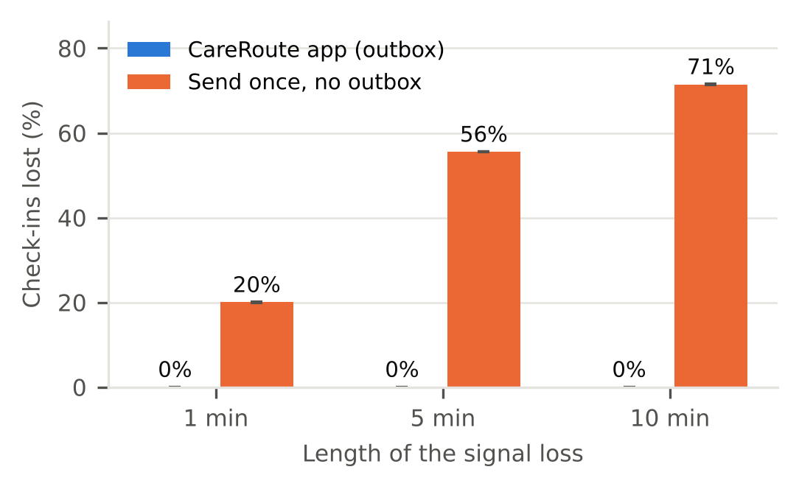
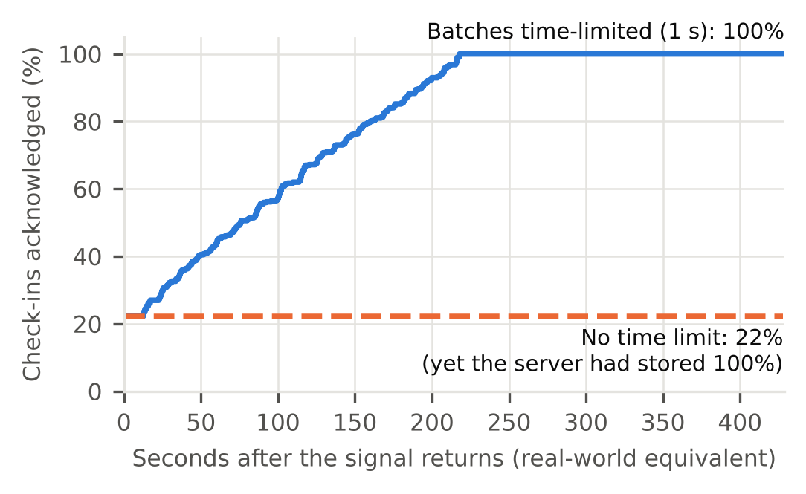
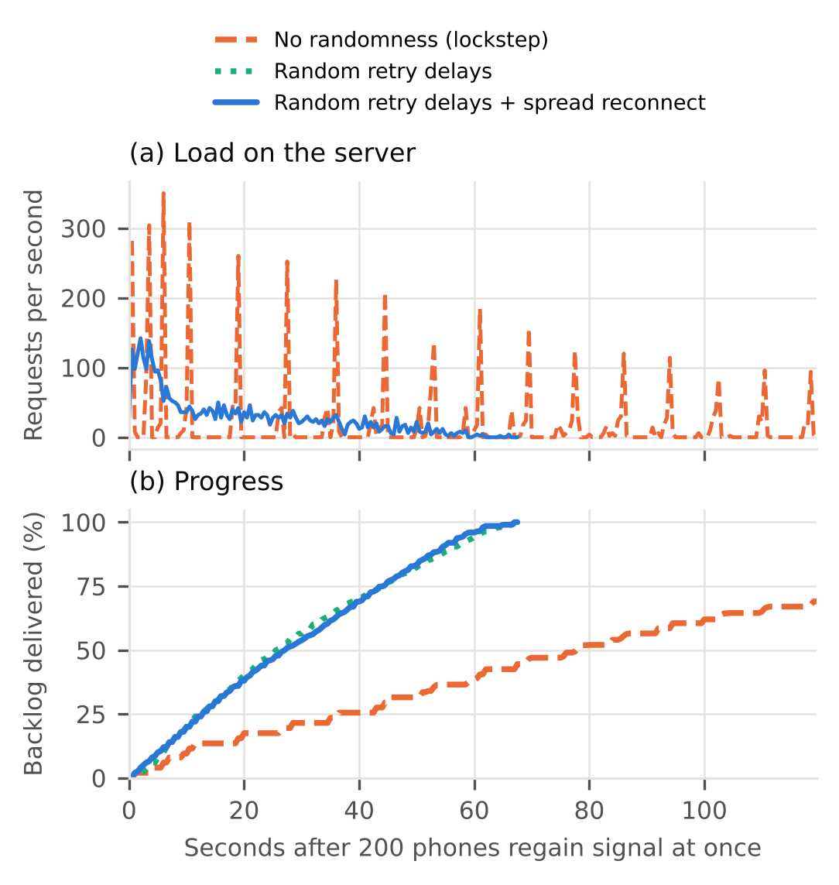
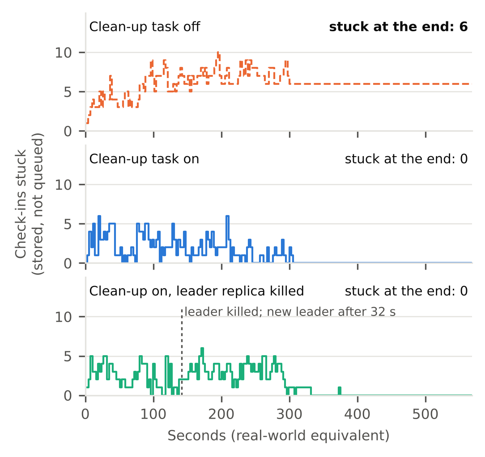
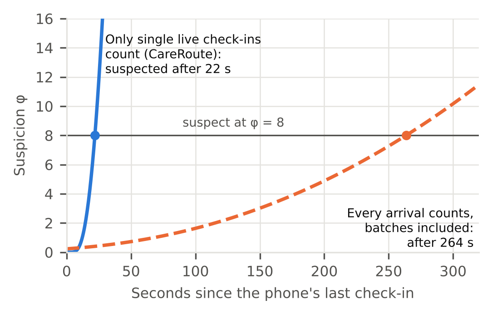

# Evaluation results

Generated by `evaluation/report.py` from the raw runs in `results/`; see [README.md](README.md) for how the experiments work and how to rerun them. Times from scaled runs are converted back to real-world seconds (×10). Every run's server logs were checked for unexpected exceptions: none found. Environment: one Linux machine with 2 CPU cores; AWS (DynamoDB, SQS) emulated with moto 5.2, Redis 7.0, Python 3.13, Node.js 22.

## Headline

- **No check-in lost by the CareRoute app**: 0 of 10,064 lost across 9 signal-loss runs (1, 5 and 10 minutes), 0 still waiting on a phone at the end, 0 extra queue copies, 0 trips out of order.
- An app that sends each check-in once lost 56% of them in a 5-minute outage.
- App closed and reopened mid-outage: 0 lost with the outbox in IndexedDB, 300 of 1,080 (28%) if it were kept in memory.
- **Retry storm found and fixed**: after a 5-minute outage, with no time limit on batches only 22% of check-ins were acknowledged to the phones by the end, although the server had stored 100%; with the 1 s limit, 100%.
- 200 phones reconnecting at once to an overloaded server: with no randomness only 69% of the backlog got through in 120 s; with random retry delays and a spread reconnect, all of it in 67 s, and the peak load fell from 350 to 142 requests/s.
- Server failing part-way, 30% of phones dying: without the clean-up task 6 check-ins stayed stuck for good; with it, 0; with the leader replica killed, another took over after 32 s and 0 were left.
- Heartbeat rule: a phone that dies right after catching up is suspected after 22 s (median) with single live check-ins only, against 268 s if every arrival counted.

## E1: signal loss (20 phones, 3 runs each)

| Outage | App | Check-ins lost | Extra queue copies | Trips out of order | Stuck on server | Left on phone | Delay of check-ins made offline, median / max | Requests per check-in |
|---|---|---|---|---|---|---|---|---|
| 1 min | CareRoute (outbox) | 0.0% | 0.0% | 0 | 0 | 0 | 52 s (51–53) / 74 s (74–75) | 0.90 (0.89–0.90) |
| 1 min | send once | 20.0% (19.9–20.1) | 0.0% | 0 | 0 | 0 | – | 1.00 |
| 5 min | CareRoute (outbox) | 0.0% | 0.0% | 0 | 0 | 0 | 236 s (230–240) / 369 s (364–377) | 0.71 (0.71–0.72) |
| 5 min | send once | 55.5% (55.5–55.6) | 0.0% | 0 | 0 | 0 | – | 1.00 |
| 10 min | CareRoute (outbox) | 0.0% | 0.0% | 0 | 0 | 0 | 473 s (470–475) / 674 s (661–680) | 0.76 (0.74–0.79) |
| 10 min | send once | 71.5% (71.4–71.5) | 0.0% | 0 | 0 | 0 | – | 1.00 |

The delay column is measured from when the check-in was made, so it includes the outage itself. After the signal returned, the scaled runs took longer to catch up than real time would: the 1:10 clock also makes the catch-up load 10 times heavier for the local emulator. The full-length run below is the realistic catch-up figure.

**Full-length check (E1-real, no time scaling, 50 phones, 10 s heartbeat, 5-minute outage):** 2400 check-ins made, 0 lost, 0 stuck, 0 left on phones, 0 trips out of order, 0.0% extra queue copies. Check-ins made offline reached the server a median 27 s after the signal returned (max 71 s): the random backoff the phone was in when the signal came back, then one batch.

**App closed and reopened in the middle of a 5-minute outage:**

| Outbox kept in | Check-ins lost |
|---|---|
| IndexedDB (the app) | 0 of 1077 (0.0%) |
| memory only | 300 of 1080 (27.8%) |

## E1-budget: the retry storm found during this evaluation

| Server batch time limit | Stored and queued on the server | Acknowledged to the phone by the end | Left on phones | Extra queue copies | Requests |
|---|---|---|---|---|---|
| none | 100% | 22% | 838 | 55 | 691 |
| 1 s (current design) | 100% | 100% | 0 | 0 | 751 |

Without a limit the server did store and queue every check-in, but each big catch-up batch took longer than the phone's timeout, so the phone gave up, resent the same batch (making duplicate work and extra queue copies), and never heard back: a retry storm that keeps itself going. With the limit every answer comes within about a second and says how many it handled (`processed`).

## E2: 200 phones regain signal at once (10 check-ins of backlog each, server capacity fixed at 4 requests at once)

| Phones' behaviour | Backlog delivered | Time to deliver 95% / all | Requests | Turned away (503) | Peak load |
|---|---|---|---|---|---|
| no randomness | 69% | – / not within 120 s | 2361 | 2166 | 350 req/s |
| random retry delays | 100% | 62 s / 68 s | 1889 | 1591 | 218 req/s |
| random retry delays + spread reconnect (CareRoute) | 100% | 59 s / 67 s | 1924 | 1636 | 142 req/s |

## E3: server fails part-way, phones die (2 replicas, 20% of queue sends fail after storing, 30% of phones die at their first failure)

| Clean-up task | Stuck at peak | Stuck at the end | Leader takeover after a crash |
|---|---|---|---|
| off | 10 | 6 | – |
| on | 6 | 0 | – |
| on, leader replica killed | 6 | 0 | 32 s (lease 30 s) |

- Clean-up off: 460 check-ins made (all stored), 454 reached the queue, 6 stuck; 0 lost from phones that stayed alive.
- Clean-up on: 466 check-ins made (all stored), 466 reached the queue, 0 stuck; 0 lost from phones that stayed alive.
- Leader killed: 450 check-ins made (all stored), 450 reached the queue, 0 stuck; 0 lost from phones that stayed alive.

The stuck count goes up and down during a run because a check-in is briefly "stuck" between being stored and being queued, and a failed queue send leaves it so until the phone retries or the clean-up task (after 30 s) finishes it. What matters is the end: only check-ins from phones that died stay stuck, and only without the clean-up task.

## E4: noticing a phone that dies right after catching up

Phi accrual failure detector (Hayashibara et al., normal model, threshold φ = 8, minimum spread 0.5 s, last 100 intervals), applied to the interval history of each of the 50 phones in E1-real after the 5-minute outage.

| Interval history | Time to suspect a dead phone (median, min–max) |
|---|---|
| normal rhythm, before the outage | 12.8 s (12.8–12.8) |
| after the outage, CareRoute rule (single live check-ins only) | 21.9 s (12.7–28.6) |
| after the outage, if every arrival counted (batches too) | 268.0 s (256.0–309.8) |

With every arrival counted, the window holds a median of 14 zero-length gaps from the catch-up batch plus the outage gap itself.

